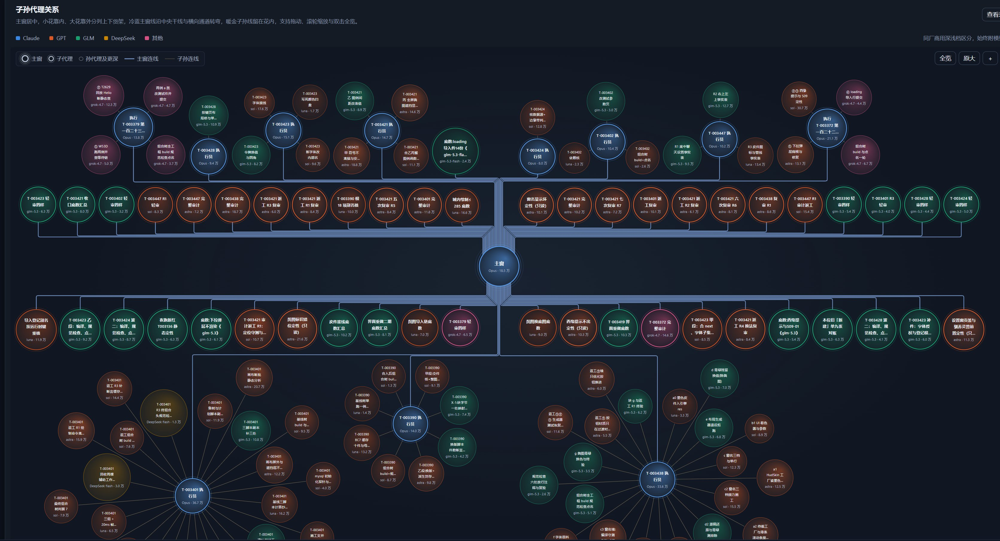

# md-workflow · Hive-style Subagents · Million-scale Code Engineering Skills

## Overview

md-workflow v2.0 combines a subtractive 14-gate constitution, a first-window requirements session, four tier subagents, short book task briefs, memory hooks, and a local runtime dashboard. It can run fully automatically, with human decision points retained as needed. It has been battle-tested on a large MMORPG engineering project. Engine: 327,866 lines of hand-written code (plus 31,334 lines of engine scene/resource text) · Server: 168,845 · Office tooling: 51,799 — counted from git-tracked files, as of 2026-10-18 (UTC-7) / 2026-10-19 03:53 (UTC+8).

Counting configuration, data, and documents as well, that project holds about 4 million git-tracked lines of working text (code ≈ 0.55M, configuration and data ≈ 2.57M, documents ≈ 0.9M). Building an AI project, and handing it from one window to the next, runs on exactly this kind of massive text; md-workflow keeps optimizing that text and retiring what has gone stale — pointer memory is rewritten rather than appended, and subtraction review retires rules that no longer earn their place.



*The runtime dashboard's subagent-relationship view, from a real session on that project: the main window in the center, subagents along the trunk lines, grandchild agents clustered around each executor, colored by model family, with token usage on every node.*

Memory and handoff are the core; the ticket desk is the work channel; the constitution supplies the workflow's gates. Use individual skills, install just the tools, or adopt the full workflow. The main directories are `core/` for tools, `desk/` for the constitution, roles, templates, and memory conventions, and `examples/` for walkthroughs.

## Standalone skills

Each skill has its own instructions and supporting material. The first eight are the recommended core set, in the same order as [the skill index](desk/skill一览.md). There are three categories: **Standalone**, **Requires `core/`**, and **Full workflow required**; a skill in the last category should not be advertised as independent of the workflow.

To install a skill, copy its entire `.agents/skills/<skill-name>/` directory into your project's `.agents/skills/` directory. For a tool-backed skill, also copy `core/` and follow the standalone setup below; for a full-workflow skill, retain its workflow dependencies. To have an AI install one, replace `<skill-name>` (for example `pointer-handoff`) and paste:

```text
Clone https://github.com/comkocs/md-workflow into a temporary directory, copy its .agents/skills/<skill-name>/ directory into my project's .agents/skills/, then read that SKILL.md and fill in its placeholders with my project's values, asking me about anything you cannot determine.
```

### ⭐ `hive-dispatch` — Hive dispatch

**Category: Standalone.** Split work, choose among the top, difficult, routine, and lightweight tiers, write bounded delegation prompts, and verify the returned work. The top tier belongs to the main window itself; the other tiers use subagents according to the job. The main window sets boundaries and checks evidence rather than accepting a worker's claim of completion; failed audits or two consecutive failures on the same job trigger escalation. Its delegation instructions and role definitions travel with the skill.

### ⭐ `pointer-handoff` — Pointer memory

**Category: Standalone.** Keep one fixed-name current-state document instead of a growing stack of handoff narratives. Rewrite section §一 with the current state, blockers, active work, and next steps; keep section §二 as stable source-file and command pointers, and move historical narrative into archives. Before compaction or changing windows, save a verified continuation point. Every reply reports what memory was actually saved, or explicitly says that memory was unchanged; the skill does not turn an unsaved conversation into persistent memory.

### ⭐ `memory-writing` — Memory writing and indexing

**Category: Standalone.** Capture a reusable rule, correction, or lesson while its evidence is still available. Search for an existing entry first, keep one fact per memory file, write the required three-part body with its source case, and add one index entry in the appropriate section. The bundled specifications cover creating, updating, and deleting entries, helping a later window find the rule without rereading the conversation.

### ⭐ `context-guard-hooks` — Memory hooks

**Category: Requires `core/`.** Install and check two advisory hooks: a post-write check for stale wording, fixed versions, size limits, or missing charter sections, and a post-compaction reinjection of saved state. Reinjection works with `/compact`: `SessionStart(compact)` triggers it after manual `/compact` or automatic compaction. The hooks only report context; they neither block edits nor save missing state for you. The skill explains configuration merging, manual JSON checks, source identification, and the limits of a tools-only installation.

### ⭐ `ticket-desk-usage` — Ticket desk usage

**Category: Requires `core/`.** Find the small set of ticket commands appropriate to your role: receive work, claim and submit it, dispatch and judge it, record blockers, check pending replies, or complete review and closeout. Its references separate local-only data access from server-connected access and distinguish exporting a task brief from actually launching a subagent. Copying `core/` and setting the office-directory key is sufficient for the tools; the workflow constitution is not required.

### ⭐ `verify-agent-claims` — Anti-hallucination claim verification

**Category: Standalone.** Apply anti-hallucination checks when another agent says something is absent, unused, finished, committed, broken, or fully passing. Establish which tree and revision the claim concerns and how it was measured, then independently verify the actual artifact through a different route before relying on it. This prevents a missed search, an outdated checkout, or a comment mistaken for behavior from becoming a downstream fact.

### ⭐ `top-audit-dispatch` — Independent anti-hallucination audit

**Category: Standalone.** After work is merged, commission an independent anti-hallucination audit against the requirements and delivered artifacts, not the implementer's narrative. The audit separates fabricated claims, typos, omissions, unchecked items, and environment limits, with counts at the start and specific mismatches below. A rework merge gets a fresh auditor rather than reusing the implementation context; bundled prompts and report material support independent verification.

### ⭐ `subtraction-review` — Subtraction review

**Category: Standalone.** Periodically review the gate ledger, temporary daily rules, size budgets, and historical appendix instead of allowing rules to accumulate indefinitely. Use evidence to choose retirement, a justified renewal, or promotion to a lasting rule, then produce the four-part review and register the decision. Steps and templates are self-contained; the user supplies the project's records and decision register.

### `first-window-requirements` — First-window requirements

**Category: Standalone.** Before creating a new project repository, collect the user's requirements verbatim, select a scale preset, and confirm a mind map, product document, and either a UI prototype or architecture diagram. Then split the agreed scope into modules and tasks and fill in coding standards, with asset-management rules only when relevant. The required skeletons are included; incomplete requirements evidence is not a reason to invent features or create the repository early.

### `legacy-project-onboarding` — Legacy-project onboarding

**Category: Standalone.** Transfer an existing project through a bounded memory export from the old window, then check what the new window understands and what is missing. Compare terminology and rule conflicts before choosing an integration scope; by default, preserve existing rules and sources and fill only authorized gaps. The skill covers export, import, compatibility, scope, and the first working window without treating onboarding as permission to scan or rewrite the old project.

### `short-book-drafting` — Short book task briefs

**Category: Standalone.** Turn a large task into five concise blocks: the problem, settled decisions, acceptance criteria and allowed changes, baseline pointers, and merge/audit/unchecked-item expectations. The main window defines what is required and where work may occur; the executor arranges the implementation. The bundled short book, lightweight gate procedure, and delegation requirements make the boundary explicit without expanding the brief into a long serial script.

### `zero-window-taskbook-drafting` — Optional two-window task brief

**Category: Full workflow required.** Use this only when a large task needs a separate executor window because of merge conflicts or cross-repository work. It checks the five-block brief, baseline, file whitelist, handoff, audit, and deviation requirements before the independent executor starts. The default single-window route uses `short-book-drafting`; task size alone does not require a second window.

### `contract-and-test-infra` — Contracts and test infrastructure

**Category: Standalone.** Prepare a backend module for a real frontend consumer rather than passing integration gaps downstream. Check the interface contract, resettable states, readable rejection reasons, and an automated end-to-end path; keep compatible contract growth, runtime configuration, and fake-transport replay in view. Use it before handoff or when integration takes unexpectedly long, with your own contract, reset command, scenario command, and configuration locations substituted.

### `frontend-integration-preflight` — Frontend integration preflight

**Category: Standalone.** Before writing integration code, verify three deliverables: a complete contract, a way to reset blocked states, and an offline replay or scenario that reaches the intended interface without a live server. All three must be usable before integration starts. If one is missing, identify the gap for the backend to fill while the frontend works on something else; this skill checks readiness rather than implementing the backend's test infrastructure.

### `shared-checkout-safety` — Shared checkout and worktree safety

**Category: Standalone.** Keep concurrent windows from overwriting each other's work by using a separate worktree per task and staging only explicitly owned paths. Inspect unexpected changes, rejected pushes, shared processes, and actual branch tips before deciding what to do. It avoids broad staging, destructive resets, and amended shared commits, so a local verification is not silently performed against someone else's changes.

### `engineering-pitfalls-checklist` — Engineering pitfalls checklist

**Category: Standalone.** Diagnose six recurring engineering traps through symptoms, an initial check, and a reading of the result. These include invisible leading bytes, claims that do not match the relevant revision, runtime-version mismatches, garbled or swallowed shell output, and intermittent test results. Use the corresponding check before blaming the code, and report measured evidence rather than an assumed cause.

### `merge-and-deploy` — Merge and deploy

**Category: Standalone.** Follow a fixed sequence for rebuilding the combined tree, building and testing the relevant scope, checking ancestry, merging, pushing, and deploying under the project's authorization. Preserve required online settings with explicit deployment flags, then read back the deployed revision and other post-deployment evidence before cleanup. Projects without an online service skip the deployment-specific steps; the skill does not itself grant permission to push or deploy.

### `closeout-report-drafting` — Closeout report drafting

**Category: Standalone.** Write a short, checkable report when a task is actually complete, or choose a handoff document when it is not. Use the fixed four-block report skeleton and answer the closing questions, keeping pending actions and deviations distinct from completed work. Verify hashes, counts, and filenames with commands, and measure the report by characters rather than trusting an estimated length.

### `window-handoff-drafting` — Window handoff drafting

**Category: Standalone.** Prepare a continuation document when a window is nearly full or work must move to a new window. Choose the template for the receiving role, retain only the current state and next steps, rewrite the fixed current-state section, and put historical narrative in archives. Verify pointers, figures, and unfinished items so the next window can continue without rereading the whole history.

### `memory-index-folding` — Memory index folding

**Category: Full workflow required.** When the memory index approaches its limit or the loaded tail has been truncated, move an entire section unchanged into a secondary volume and leave one entry at the original location. Back up, preview, fold, and compare entries so nothing is lost; deleting lessons is not a substitute for folding. This skill depends on the full workflow's memory-index conventions and folding tool.

### `open-source-preflight` — Open-source preflight

**Category: Standalone.** Before publication, check the proposed tree and history for secrets, deployment details, local paths, identities, and material that lacks redistribution rights. Separate runnable scans from licensing and authorization evidence that requires human confirmation, and record missing tools or evidence as unchecked rather than as zero findings. The skill does not authorize publishing, rewriting history, or removing assets on its own.

### `claude-session-observability` — Local session observability

**Category: Requires `core/`.** Use the local runtime dashboard to inspect windows, descendant-agent trees, timelines, active concurrency, model and task usage, rule alerts, and history. It covers Claude Code session records only, not codex or zcode windows; it reads records without changing them or displaying conversation bodies. The skill also points to pricing, billing, and alert configuration so reported costs are not mistaken for verified charges without a configured basis.

### `repo-scale-reporting` — Repository scale reporting

**Category: Requires `core/`.** Measure one or more repositories from git-tracked files, keeping code, tests, configuration, and documentation separate through explicit classification rules. Report the cutoff time, resolved revisions, extension and exclusion rules, and whether blank lines, comments, and merges are included. The tool also measures commits and changes within a stated time window; a number without its tree and counting scope is not a reproducible scale report.

### `doc-pointer-check` — Documentation pointer checks

**Category: Requires `core/`.** Check five kinds of Markdown pointers: gate numbers, versions, paths, task references, and file-and-line references. Scan explicit roots when only a bounded change is relevant, or compare with a previous run to isolate new dangling references. The tool is read-only and writes its findings into a report directory; its exit code is always zero, so inspect the findings rather than treating a successful process exit as a clean result.

## Memory hooks and pointer handoff

Start with saved state, not a larger transcript. Keep one fixed-name `接管_现状.md`: section §一 describes what is true now, what is blocked, which agents are active, and what happens next; section §二 lists stable source paths and commands. Rewrite the current state rather than appending a diary, keep history in archives, and verify the pointers before handing off. Each reply distinguishes a real memory save from an unchanged memory state; see [`pointer-handoff`](.agents/skills/pointer-handoff/SKILL.md).

The two hooks in `core/tools/hooks/` are complementary. `防回潮检查.py` is an advisory `PostToolUse` check after `Write|Edit|MultiEdit`; `压缩后回灌.py` works with `/compact` and is triggered by `SessionStart(compact)` after manual `/compact` or automatic compaction. It reinjects the saved current-state section, current daily rules, and recently active subagents; if it cannot identify the role, it supplies only the daily rules. Save the state before compaction: a hook cannot recover facts that were never written down.

Both scripts use the standard library and only emit guidance, not edit blocks. Follow [`context-guard-hooks`](.agents/skills/context-guard-hooks/SKILL.md) to merge event configuration without replacing existing settings and to check the actual reinjection sources. Preserve three things in a compact summary: decisions with timestamps, cross-window values and time windows, and active agents with what they are waiting for and what to do when they return. A zero exit code or no output alone does not prove installation succeeded; in a `core/`-only setup, checks needing an absent workflow word list or budget table are skipped.

## ⭐ Standalone: ticket desk and runtime dashboard

To use the ticket desk and runtime dashboard without the constitution, copy just the `core/` directory into a tools directory of your choice and change the `办公目录` key in `core/desk_config.json` to your own office-document directory, which need not exist yet. These tools use only Python's standard library; `desk/`, `.agents/`, and the workflow constitution are not prerequisites. Install any selected skills separately using the method above.

Run these commands from the directory containing the copied `core/`:

```bash
python -X utf8 core/start.py
python -X utf8 core/t.py -h
python -X utf8 -I core/tools/dashboard/server.py
```

The first command starts the ticket desk, the second lists its local-only CLI commands, and the third starts the dashboard independently in isolated mode; use the local address printed by each service and stop a foreground service with Ctrl+C. If the local ticket desk is already running, its “Runtime dashboard” entry opens the dashboard in the same process and on the same port, so a second dashboard process is unnecessary. The dashboard covers Claude Code records only and does not modify session records. See [the dashboard guide](core/tools/dashboard/README.md) for coverage and configuration.

Paste this one-sentence activation instruction into your AI window; it fetches the project from GitHub itself:

```text
Clone https://github.com/comkocs/md-workflow into a temporary directory, copy only its core/ directory into my chosen tools directory, set the 办公目录 key in core/desk_config.json to my office-document directory (ask me for both directories if I have not given them), then start the local ticket desk with python -X utf8 core/start.py and open its Runtime dashboard entry, without installing the workflow constitution or changing my existing rules.
```

For an isolated ticket-desk demonstration, use `python -X utf8 core/start.py --demo`; its data is separate from the regular desk. For a complete worked task, follow [the walkthrough](examples/README.md).

## Start the full workflow

Read [the startup guide](desk/开局向导.md) and choose its initial branch: **new project**, **legacy-project handoff**, or **workflow-only installation**. A new project completes the first-window requirements work before repository creation; a legacy project first preserves and checks its existing rules and sources; workflow-only installation skips requirements intake and uses the existing repository where appropriate.

Paste this instruction into an AI window opened in your project directory; the guide clones the project itself:

```text
Execute all instructions in https://github.com/comkocs/md-workflow/blob/main/desk/开局向导.md: first choose the new-project, legacy-project handoff, or workflow-only branch that fits my situation, then carry out that branch within my authorization and retain the human decision points I specify.
```

The full workflow combines pointer-based memory, ticketed work, independent verification, and the subtractive constitution. The product release is **v2.0**; the current constitution document is **v2.1**, with **14 gates**: 11 core and 3 optional. Automation stays within the user's authorization; selected human decisions can remain in the loop, and core gates are not optional switches. The tier names route work, not mandate a particular model: the main window handles the top tier, while difficult, routine, and lightweight work can be delegated.

## License

Released under [Apache-2.0](LICENSE). Redistribution and derivative releases must retain the attribution notices in [NOTICE](NOTICE), as required by section 4 of the license.

## Background (translated)

This project grew out of a failure. On August 25, I wrote the first line of code. In one month, more than 600,000 lines of effective C# code brought the game fully to life, with updates continuing every day; md-workflow has now reached v2.0.

---

# md-workflow · 蜂巢式子代理 · 百万级代码工程 skill

以下为完整中文译本，与英文版结构一致。

## 总览

md-workflow v2.0 包含宪法 14 闸减法版、首次需求对接窗、四档子代理、短书、记忆钩子与本机运行看板。可全自动运行，拍板点可按需保留。已经过大型 MMORPG 工程实战验证。引擎手写代码 327,866 行（另有引擎场景／资源等资产文本 31,334 行）· 服务端代码 168,845 行 · 办公代码 51,799 行——按 git 跟踪文件计，统计截止 2026-10-18（UTC-7）／2026-10-19 03:53（UTC+8）。

连配置数据与文档一起算，该工程按 git 跟踪文件合计约 400 万行工作文本（代码约 55 万、配置与数据约 257 万、文档约 90 万）。AI 项目的构建与传递，靠的就是这样的海量文本；本项目能不断优化文本、淘汰文本——指针记忆覆盖式重写而不是追加，减法审定期淘汰不再值得留的规矩。


*运行看板「子孙代理关系」视图，取自该工程的一次真实会话：主窗居中，子代理沿主干排开，孙代理围在各执行员四周，按模型家族着色，每个节点标出用量。*

记忆与接管是内核，工单台是工作通道，宪法提供流程闸口。可以只用独立 skill、只装工具，也可以采用整套工作流。主要目录是工具 `core/`、宪法／角色／模板／记忆规范 `desk/`，以及演练案例 `examples/`。

## 独立 skill

每个 skill 都有自己的指令与配套材料。前八个是建议优先选择的核心项，顺序与 [skill 一览](desk/skill一览.md) 一致。分类共三类：**单独装即可用**、**装 core/ 即可用**、**需要 md-workflow 全套**；最后一类不能宣传成脱离工作流也能独立使用。

安装时，把 `.agents/skills/<skill-name>/` 整个目录拷到你项目的 `.agents/skills/` 下。依赖工具的 skill 还要拷 `core/` 并按下文单独安装；依赖全套工作流的 skill 则须保留其流程依赖。想让 AI 代装，把 `<skill-name>` 换成要装的名字（如 `pointer-handoff`）后贴这一句：

```text
把 https://github.com/comkocs/md-workflow 克隆到一个临时目录，把其中 .agents/skills/<skill-name>/ 整个目录拷到我项目的 .agents/skills/ 下，再读该 SKILL.md，按我项目的实值填好其中占位，定不了的问我。
```

### ⭐ `hive-dispatch` — 蜂巢式派遣

**分类：单独装即可用。** 帮你切活、在顶级／困难／日常／轻量四档中选档、写清派遣边界，并核验交回的成果。顶级由主窗本体承担，其余按活派子代理。主窗定边界、看证据，不凭施工者一句「做完了」放行；审计不过或同活连续失败两次就升档。派遣步骤与角色定义随 skill 自带。

### ⭐ `pointer-handoff` — 指针记忆

**分类：单独装即可用。** 把越堆越长的接管记录改成一份固定名现状件。§一 覆盖式重写当前状态、阻塞、在办事项与下一步；§二 只留稳定的真源路径和命令指针，历史流水放归档。压缩或换窗前先保存核实过的接续点。每次回复都报实际存了什么，没存就明确说「记忆未动」，不会把未落盘的对话冒充持久记忆。

### ⭐ `memory-writing` — 记忆写入与索引

**分类：单独装即可用。** 在证据还清楚时，记下以后还会用到的规矩、纠正或教训。先查同题，一文件一事实，按要求写正文三段和源案例，再在索引对应节加一行。自带规范覆盖新建、更新与删除，让下一窗能直接找到规矩，不必重读对话。

### ⭐ `context-guard-hooks` — 记忆钩子

**分类：装 core/ 即可用。** 安装并自查两道提示钩子：写文件后检查旧词、写死版本、体积超限或章程缺节，压缩后回灌已保存的现状。回灌配合 `/compact` 使用，手动 `/compact` 或自动压缩后由 `SessionStart(compact)` 触发。钩子只提示，不拦截编辑，也不会替你保存缺失的现状。skill 讲清配置合并、JSON 手动自查、来源识别与只装工具时的能力边界。

### ⭐ `ticket-desk-usage` — 工单台用法

**分类：装 core/ 即可用。** 按自己的角色找到那几步工单命令：接活、认领交板、派活判活、记录阻塞、查待答、复验收尾。配套说明区分只读写本机的数据入口与可连服务器的入口，也区分「导出任务书」和「真的派出子代理」。只拷 `core/` 并填好办公目录键即可使用工具，不要求安装工作流宪法。

### ⭐ `verify-agent-claims` — 核子代理与他人报告（防幻觉）

**分类：单独装即可用。** 在别人报「没有」「没人用」「做完了」「已提交」「会崩」「全绿」时先做防幻觉核实。问清对方看的树与版本、怎么算的，再换一条路独立核实物后才采信。避免搜漏、旧检出或把注释当行为得到的结论，被写成下游事实。

### ⭐ `top-audit-dispatch` — 独立顶级审计（防幻觉）

**分类：单独装即可用。** 一单并入后，另派独立审计者按需求和实际交付物做防幻觉核验，不照施工者的自述判。审计把幻觉、笔误、漏做、未核与环境限制分开，首行给计数，下列具体不符项。返工再并后另起新审计，不沿用施工上下文；自带提示词与报告材料支持独立核实。

### ⭐ `subtraction-review` — 减法审

**分类：单独装即可用。** 定期清闸账、当日口径、预算表与历史附录，避免规矩只加不减。按实证判退役、带理由续期或转长期，产出四块减法审报告并登记裁定。步骤和模板自包含，项目记录与裁定簿由使用方提供。

### `first-window-requirements` — 首次需求对接

**分类：单独装即可用。** 新项目建仓前，先逐字收需求、判规模选预设，再确认思维导图、产品文档与原型图或架构图。确认后把范围拆成模块与单，填好代码规范，有相关素材时才补素材管理规范。所需骨架自带；证据不齐不能靠编功能或提前建仓补过去。

### `legacy-project-onboarding` — 老项目接入

**分类：单独装即可用。** 先让老窗口做一份有边界的记忆导出，再核新窗口理解了什么、缺什么。对齐术语与规矩冲突后再选接入范围，默认保留现有规矩和真源，只补已授权的缺口。覆盖导出、导入、兼容、范围与第一窗，不把接入当成扫描或重写老项目的许可。

### `short-book-drafting` — 短书起草

**分类：单独装即可用。** 把大型工单压成五块：出题、已定口径、判据与改动面、底数指针、并线／审计／未核要求。主窗定要什么和只许改哪里，执行员自己编排施工。自带短书、轻闸工序与派遣要求，交清边界，而不是把任务书扩成长串行脚本。

### `zero-window-taskbook-drafting` — 0 号任务书起草（选用，仅双窗）

**分类：需要 md-workflow 全套。** 只在甲类大型因并线冲突或跨仓而需要独立执行员窗时使用。开工前核五块短书、底数、文件白名单、交接、审计与偏离要求。默认单窗走 `short-book-drafting`，不能只因任务大就另开第二窗。

### `contract-and-test-infra` — 前后端契约与测试基建

**分类：单独装即可用。** 后端交前端前，先补真实消费者，而不是把对接缺口往下游推。核接口契约、状态可复位、拒因可读与自动完整流程，同时照顾兼容的契约扩展、运行时配置和假传输层回放。适合交付前或联调明显超时，用前换成自己的契约、复位命令、场景命令与配置位置。

### `frontend-integration-preflight` — 前端对接预检

**分类：单独装即可用。** 前端动手前先核三件：契约齐、卡住的状态能复位、不连真服也能靠回放或场景到达目标界面。三件都可用才开工。缺一件就说清缺口退回后端补，前端先做别的；本 skill 只核准备度，不代替后端实现测试基建。

### `shared-checkout-safety` — 共用检出与工作树

**分类：单独装即可用。** 一单一工作树，暂存只带明确归自己改的路径，避免并发窗口互踩。遇到陌生改动、推送被拒、共享进程或支头不符，先看清再处理。避免广泛暂存、破坏性重置和改写共用提交，防止本机核验悄悄验成别人的代码。

### `engineering-pitfalls-checklist` — 工程坑清单

**分类：单独装即可用。** 把六类常见工程坑写成症状、先跑的检查、结果怎么看，包括首字节多出不可见内容、回报与对应版本对不上、运行时版本不符、shell 乱码或命令被吞、测试时过时不过。先按症状做对应检查，再决定是不是代码问题；回报实测证据，不先猜原因。

### `merge-and-deploy` — 并线上服

**分类：单独装即可用。** 在项目授权范围内，按固定顺序重建组合树、构建与测试相关改动面、查祖先、并线、推送和部署。显式带保留线上设置的旗标，上线后回读运行版本及其他实证再收尾。没有线上服务的项目跳过部署步骤；skill 本身不授予推送或上服权限。

### `closeout-report-drafting` — 收口报告起草

**分类：单独装即可用。** 真做完才写短、可逐条核对的收口报告，没做完改写交接件。按固定四块骨架与收尾问题写，区分已完成、待别人接着做与偏离。哈希、计数、文件名用命令核，篇幅按字符量，不凭感觉估长度。

### `window-handoff-drafting` — 换窗归档起草

**分类：单独装即可用。** 旧窗快满或要转交工作时，按接手角色选模板，留下当前现状与下一步。固定现状节覆盖式重写，历史流水进归档。核指针、数字和未完事项，让下一窗不用整读历史也能续做。

### `memory-index-folding` — 记忆索引折叠

**分类：需要 md-workflow 全套。** 索引将满或加载末尾被截断时，把一整节原样挪入二级分册，原处只留一行入口。先备份、预演、折叠，再逐条对照，不能靠删教训来瘦身。依赖全套工作流的索引规范与折叠工具。

### `open-source-preflight` — 开源前检查

**分类：单独装即可用。** 公开前核准备发布的树和历史，查秘密、部署信息、本机路径、身份与缺再分发权的素材。能跑的扫描与须人工确认的版权、授权证据分开；缺工具或证据记未核，不冒充零命中。skill 本身不授权发布、重写历史或自行移除素材。

### `claude-session-observability` — 本机会话看板

**分类：装 core/ 即可用。** 用本机运行看板查看窗口、子孙代理树、时间轴、在跑并发、按模型与按单用量、规矩报警及历史。只覆盖 Claude Code 会话记录，不包含 codex／zcode 窗；只读记录，不修改记录、不展示对话正文。还给出价目、计费口径与报警配置位置，避免未配口径就把估算当成已核费用。

### `repo-scale-reporting` — 代码规模统计

**分类：装 core/ 即可用。** 按 git 跟踪文件量一个或多个仓，通过明确分类规则把代码、测试、配置与文档分开。报告写统计截止时间、解析后的版本、扩展名与排除项，以及空行、注释和合并是否计入。工具也量指定时间窗的提交与增删量；不带树与口径的数字不能复现。

### `doc-pointer-check` — 文档断引用检查

**分类：装 core/ 即可用。** 核 Markdown 的闸号、版本号、路径、任务引用、文件与行五类指针。只核有边界的改动时可指定扫描根，也可对比上一跑只看新增悬空。工具只读被扫件、把结果写入报告目录，退出码恒为零，所以要看悬空清单，不能把进程成功当作没有断引用。

## 记忆钩子与指针接管

先保存现状，不靠更长的聊天记录。固定一份 `接管_现状.md`：§一 写此刻实情、阻塞、在跑代理与下一步；§二 列稳定真源路径和命令。现状覆盖式重写而不是追加日记，历史进归档，交接前核指针。每次回复分清真存了记忆还是记忆未动，见 [`pointer-handoff`](.agents/skills/pointer-handoff/SKILL.md)。

`core/tools/hooks/` 两道钩子各管一件事。`防回潮检查.py` 在 `Write|Edit|MultiEdit` 后由 `PostToolUse` 提示；`压缩后回灌.py` 配合 `/compact`，手动 `/compact` 或自动压缩后由 `SessionStart(compact)` 触发。回灌已存现状节、当日口径与近期仍在跑的子代理，认不出本位时只给当日口径。压缩前先保存，没写下来的事实不能靠钩子找回来。

两脚本只用标准库，只输出提示，不拦截编辑。按 [`context-guard-hooks`](.agents/skills/context-guard-hooks/SKILL.md) 合并事件配置、保留原设置并核实际回灌来源。压缩摘要保住三样：带时刻的拍板、跨窗数值与时段、在跑代理及其等待项和返回动作。退出码为零或没有输出都不能单独证明安装成功；只装 `core/` 时，需要外置流程词表或预算表的检查会跳过。

## ⭐ 单独安装：工单台与运行看板

不装宪法也能用工单台与运行看板：只拷 `core/` 一个目录到自己选的工具目录，把 `core/desk_config.json` 的「办公目录」改成自己的办公文件目录，该目录可以尚不存在。工具只用 Python 标准库，不依赖 `desk/`、`.agents/` 或工作流宪法。要用的 skill 按上文另装。

在所拷 `core/` 的父目录运行：

```bash
python -X utf8 core/start.py
python -X utf8 core/t.py -h
python -X utf8 -I core/tools/dashboard/server.py
```

第一条起工单台，第二条列只读写本机数据的命令行用法，第三条以隔离模式独立起看板；打开各服务终端打印的本机地址，前台服务按 Ctrl+C 停止。本机工单台已起时，点顶栏「运行看板」即可同进程、同端口打开，不必再起第二个看板进程。看板只覆盖 Claude Code 记录，不改会话记录。覆盖范围与配置详见 [看板说明](core/tools/dashboard/README.md)。

把这一句激活指令贴给 AI，它会自己从 GitHub 拉取项目：

```text
把 https://github.com/comkocs/md-workflow 克隆到一个临时目录，只把其中的 core/ 拷到我选定的工具目录，把 core/desk_config.json 的「办公目录」设为我的办公文件目录（两个目录我没给就先问我），再用 python -X utf8 core/start.py 启动本机工单台并打开顶栏「运行看板」，不安装工作流宪法、不改我的现有规矩。
```

想独立演练工单台，用 `python -X utf8 core/start.py --demo`，演示数据与正式台分开。完整走一张单见 [演练说明](examples/README.md)。

## 启动整套工作流

读 [开局向导](desk/开局向导.md)，在首页选 **新项目**、**接管老项目** 或 **只装流程**。新项目先完成首次需求对接再建仓；老项目先保留并核现有规矩与真源；只装流程跳过需求对接，适用时沿用现有仓。

在项目目录开一个 AI 窗贴这一句，向导会自己克隆项目：

```text
执行 https://github.com/comkocs/md-workflow/blob/main/desk/开局向导.md 的全部指令，先按我的情况选择新项目、接管老项目或只装流程，再在我的授权范围内完成对应分支，并保留我指定的人工拍板点。
```

整套工作流把指针记忆、工单制、独立核验与减法宪法合在一起。产品版本是 **v2.0**；现行宪法文档为 **v2.1**，共 **14 闸**，其中核心 11、可选 3。全自动仍受用户授权约束，按需保留人工拍板，核心闸不能当可选开关关掉。档位用于分工，不绑定某个模型：顶级由主窗做，困难、日常、轻量可交子代理。

## 许可

采用 [Apache-2.0](LICENSE)。再分发或发布衍生作品时须按许可第 4 条保留 [NOTICE](NOTICE) 中的归属声明。

## 作者亲笔

这个项目诞生于一次失败。8月25日，我写下第一行代码。一个月，60多万行有效C#代码，游戏完整运行，每天都在不断更新中，目前md-workflow项目已经迭代到 v2.0 了。
