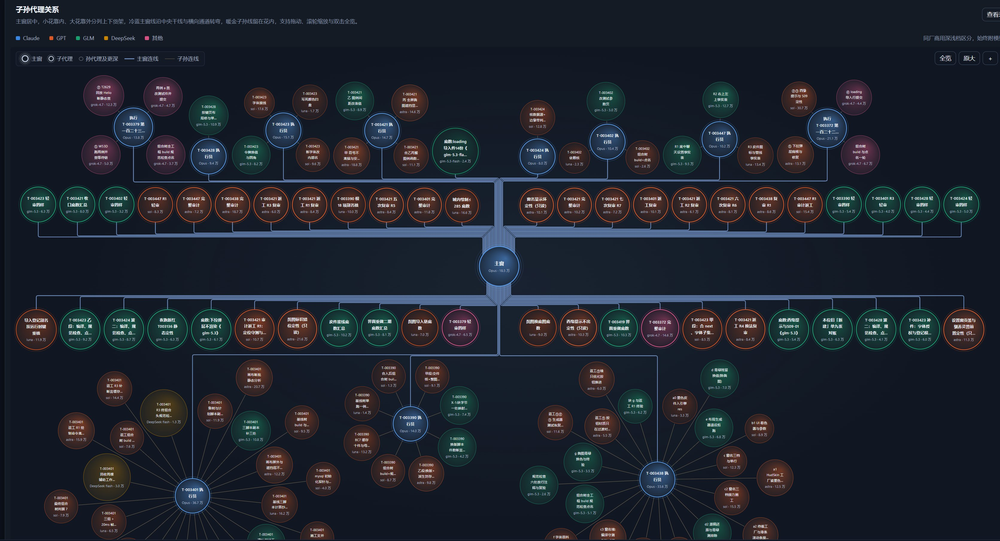

<div align="center">

# md-workflow · Hive-style Subagents · Million-scale Code Engineering Skills

       

[English](README.md) | [中文](README.zh-CN.md)

</div>

**Optional — let AI design the product development document first:** in any AI chat or code window, paste: `Execute all instructions in https://github.com/comkocs/md-workflow/blob/main/desk/先核对产品需求.md to help me design a product development document and revise it over multiple rounds until finalized; if you cannot open the link, ask me to download that Markdown file and drag it into the conversation.` You can skip this step if you already have complete product requirements and a development roadmap.

**Start building the workflow:** open an AI code window (Claude Code or VS Code) in your project directory and paste: `Execute all instructions in https://github.com/comkocs/md-workflow/blob/main/desk/开始搭建工作流.md: first choose the new-project, legacy-project handoff, or workflow-only branch that fits my situation; for a new project, do only the requirements intake first and build the repository only after I confirm; stay within my authorization throughout and retain the human decision points I specify.`

## 🧭 Overview

md-workflow v2.1 combines a subtractive 14-gate constitution, a first-window requirements session, four tier subagents, short book task briefs, memory hooks, and a local runtime dashboard. It can run fully automatically, with human decision points retained as needed. It stays lightweight: Claude Code or VS Code alone is enough to run it, with no harness needed, and the edition that comes with a harness is called Panedesk. It has been battle-tested on a large MMORPG engineering project. Engine: 327,866 lines of hand-written code (plus 31,334 lines of engine scene/resource text) · Server: 168,845 · Office tooling: 51,799 — counted from git-tracked files, as of 2026-10-18 (UTC-7) / 2026-10-19 03:53 (UTC+8).

Counting configuration, data, and documents as well, that project holds about 4 million git-tracked lines of working text (code ≈ 0.55M, configuration and data ≈ 2.57M, documents ≈ 0.9M). Building an AI project, and handing it from one window to the next, runs on exactly this kind of massive text; md-workflow keeps optimizing that text and retiring what has gone stale — pointer memory is rewritten rather than appended, and subtraction review retires rules that no longer earn their place.



*The runtime dashboard's subagent-relationship view, from a real session on that project: the main window in the center, subagents along the trunk lines, grandchild agents clustered around each executor, colored by model family, with token usage on every node.*

Memory and handoff are the core; the ticket desk is the work channel; the constitution supplies the workflow's gates. Use individual skills, install just the tools, or adopt the full workflow. The main directories are `core/` for tools, `desk/` for the constitution, roles, templates, and memory conventions, `desk/真源/` for the general working-rule set that a new project trims from, and `examples/` for walkthroughs.

## 🚀 Start a new project

The first window checks your requirements and, when a product document is available, assesses the project directly from it. It then trims working rules to fit the project from the source table in `desk/真源/`, which holds 215 entries drawn from the current rules of a million-line MMORPG project, each with its reason and the condition for adding it back. Projects with up to 200,000 lines of code default to an editor-in-chief and a technical director; larger projects may add directors by module. A single-window setup is used only when you explicitly request it. Use the **Start building the workflow** instruction at the top and choose its new-project branch.

## 🧰 Standalone skills

Each skill has its own instructions and supporting material. The first eight are the recommended core set, in the same order as [the skill index](desk/skill一览.md). There are three categories: **Standalone**, **Requires `core/`**, and **Full workflow required**; a skill in the last category should not be advertised as independent of the workflow.

To install a skill, copy its entire `.agents/skills/<skill-name>/` directory into your project's `.agents/skills/` directory. For a tool-backed skill, also copy `core/` and follow the standalone setup below; for a full-workflow skill, retain its workflow dependencies. To have an AI install one, replace `<skill-name>` (for example `pointer-handoff`) and paste:

```text
Clone https://github.com/comkocs/md-workflow into a temporary directory, copy its .agents/skills/<skill-name>/ directory into my project's .agents/skills/, then read that SKILL.md and fill in its placeholders with my project's values, asking me about anything you cannot determine.
```

### ⭐ `hive-dispatch` — Hive dispatch

**Category: Standalone.** Split work, choose among the top, difficult, routine, and lightweight tiers, write bounded delegation prompts, and verify the returned work. The top tier belongs to the main window itself; the other tiers use subagents according to the job. The main window sets boundaries and checks evidence rather than accepting a worker's claim of completion; failed audits or two consecutive failures on the same job trigger escalation. Its delegation instructions and role definitions travel with the skill.

### ⭐ `pointer-handoff` — Pointer memory

**Category: Standalone.** Keep one fixed-name current-state document instead of a growing stack of handoff narratives. Rewrite section §一 with the current state, blockers, active work, and next steps; keep section §二 as stable source-file and command pointers, and move historical narrative into archives. Before compaction or changing windows, save a verified continuation point. Every reply reports what memory was actually saved, or explicitly says that memory was unchanged; the skill does not turn an unsaved conversation into persistent memory.

### ⭐ `memory-writing` — Memory writing and indexing

**Category: Standalone.** Capture a reusable rule, correction, or lesson while its evidence is still available. Search for an existing entry first, keep one fact per memory file, write the required three-part body with its source case, and add one index entry in the appropriate section. The bundled specifications cover creating, updating, and deleting entries, helping a later window find the rule without rereading the conversation.

### ⭐ `context-guard-hooks` — Memory hooks

**Category: Requires `core/`.** Install and check two advisory hooks: a post-write check for stale wording, fixed versions, size limits, or missing charter sections, and a post-compaction reinjection of saved state. Reinjection works with `/compact`: `SessionStart(compact)` triggers it after manual `/compact` or automatic compaction. These two hooks only report context; they neither block edits nor save missing state for you. A third hook, `危险命令拦.py`, blocks four dangerous Bash command forms and returns an alternative command. The skill explains configuration merging, manual JSON checks, source identification, and the limits of a tools-only installation.

### ⭐ `ticket-desk-usage` — Ticket desk usage

**Category: Requires `core/`.** Find the small set of ticket commands appropriate to your role: receive work, claim and submit it, dispatch and judge it, record blockers, check pending replies, or complete review and closeout. Its references separate local-only data access from server-connected access and distinguish exporting a task brief from actually launching a subagent. Copying `core/` and setting the office-directory key is sufficient for the tools; the workflow constitution is not required.

### ⭐ `verify-agent-claims` — Anti-hallucination claim verification

**Category: Standalone.** Apply anti-hallucination checks when another agent says something is absent, unused, finished, committed, broken, or fully passing. Establish which tree and revision the claim concerns and how it was measured, then independently verify the actual artifact through a different route before relying on it. This prevents a missed search, an outdated checkout, or a comment mistaken for behavior from becoming a downstream fact.

### ⭐ `top-audit-dispatch` — Independent anti-hallucination audit

**Category: Standalone.** After work is merged, commission an independent anti-hallucination audit against the requirements and delivered artifacts, not the implementer's narrative. The audit separates fabricated claims, typos, omissions, unchecked items, and environment limits, with counts at the start and specific mismatches below. A rework merge gets a fresh auditor rather than reusing the implementation context; bundled prompts and report material support independent verification.

### ⭐ `subtraction-review` — Subtraction review

**Category: Standalone.** Periodically review the gate ledger, temporary daily rules, size budgets, and historical appendix instead of allowing rules to accumulate indefinitely. Use evidence to choose retirement, a justified renewal, or promotion to a lasting rule, then produce the six-part review and register the decision. Steps and templates are self-contained; the user supplies the project's records and decision register.

### `first-window-requirements` — First-window requirements

**Category: Standalone.** Before creating a new project repository, collect the user's requirements verbatim; distill ten questions to fill a requirements card, set the tier by the ruler, trim out the working rules, and select a preset; and confirm a mind map, product document, and either a UI prototype or architecture diagram. Then split the agreed scope into modules and tasks and fill in coding standards, with asset-management rules only when relevant. The required skeletons are included; also copy `desk/真源/` alongside the skill. Incomplete requirements evidence is not a reason to invent features or create the repository early.

### `legacy-project-onboarding` — Legacy-project onboarding

**Category: Standalone.** Transfer an existing project through a bounded memory export from the old window, then check what the new window understands and what is missing. Compare terminology and rule conflicts before choosing an integration scope; by default, preserve existing rules and sources and fill only authorized gaps. The skill covers export, import, compatibility, scope, and the first working window without treating onboarding as permission to scan or rewrite the old project.

### `short-book-drafting` — Short book task briefs

**Category: Standalone.** Turn a large task into five concise blocks: the problem, settled decisions, acceptance criteria and allowed changes, baseline pointers, and merge/audit/unchecked-item expectations. The main window defines what is required and where work may occur, and the build window dispatches subagents to implement it directly; an executor takes over only when a fallback trigger fires. The bundled short book, lightweight gate procedure, and delegation requirements make the boundary explicit without expanding the brief into a long serial script.

### `zero-window-taskbook-drafting` — Optional two-window task brief

**Category: Full workflow required.** Use this only when a large task meets any fallback trigger in Constitution §0.1 and needs a separate executor window. It checks the five-block brief, baseline, file whitelist, handoff, audit, and deviation requirements before the independent executor starts. The default single-window route uses `short-book-drafting`; task size alone does not require a second window.

### `contract-and-test-infra` — Contracts and test infrastructure

**Category: Standalone.** Prepare a backend module for a real frontend consumer rather than passing integration gaps downstream. Check the interface contract, resettable states, readable rejection reasons, and an automated end-to-end path; keep compatible contract growth, runtime configuration, and fake-transport replay in view. Use it before handoff or when integration takes unexpectedly long, with your own contract, reset command, scenario command, and configuration locations substituted.

### `frontend-integration-preflight` — Frontend integration preflight

**Category: Standalone.** Before writing integration code, verify three deliverables: a complete contract, a way to reset blocked states, and an offline replay or scenario that reaches the intended interface without a live server. All three must be usable before integration starts. If one is missing, identify the gap for the backend to fill while the frontend works on something else; this skill checks readiness rather than implementing the backend's test infrastructure.

### `shared-checkout-safety` — Shared checkout and worktree safety

**Category: Standalone.** Keep concurrent windows from overwriting each other's work by using a separate worktree per task and staging only explicitly owned paths. Inspect unexpected changes, rejected pushes, shared processes, and actual branch tips before deciding what to do. It avoids broad staging, destructive resets, and amended shared commits, so a local verification is not silently performed against someone else's changes.

### `engineering-pitfalls-checklist` — Engineering pitfalls checklist

**Category: Standalone.** Diagnose six recurring engineering traps through symptoms, an initial check, and a reading of the result. These include invisible leading bytes, claims that do not match the relevant revision, runtime-version mismatches, garbled or swallowed shell output, and intermittent test results. Use the corresponding check before blaming the code, and report measured evidence rather than an assumed cause.

### `merge-and-deploy` — Merge and deploy

**Category: Standalone.** Follow a fixed sequence for rebuilding the combined tree, building and testing the relevant scope, checking ancestry, merging, pushing, and deploying under the project's authorization. Preserve required online settings with explicit deployment flags, then read back the deployed revision and other post-deployment evidence before cleanup. Projects without an online service skip the deployment-specific steps; the skill does not itself grant permission to push or deploy.

### `closeout-report-drafting` — Closeout report drafting

**Category: Standalone.** Write a short, checkable report when a task is actually complete, or choose a handoff document when it is not. Use the fixed four-block report skeleton and answer the closing questions, keeping pending actions and deviations distinct from completed work. Verify hashes, counts, and filenames with commands, and measure the report by characters rather than trusting an estimated length.

### `window-handoff-drafting` — Window handoff drafting

**Category: Standalone.** Prepare a continuation document when a window is nearly full or work must move to a new window. Choose the template for the receiving role, retain only the current state and next steps, rewrite the fixed current-state section, and put historical narrative in archives. Verify pointers, figures, and unfinished items so the next window can continue without rereading the whole history.

### `memory-index-folding` — Memory index folding

**Category: Full workflow required.** When the memory index approaches its limit or the loaded tail has been truncated, move an entire section unchanged into a secondary volume and leave one entry at the original location. Back up, preview, fold, and compare entries so nothing is lost; deleting lessons is not a substitute for folding. This skill depends on the full workflow's memory-index conventions and folding tool.

### `open-source-preflight` — Open-source preflight

**Category: Standalone.** Before publication, check the proposed tree and history for secrets, deployment details, local paths, identities, and material that lacks redistribution rights. Separate runnable scans from licensing and authorization evidence that requires human confirmation, and record missing tools or evidence as unchecked rather than as zero findings. The skill does not authorize publishing, rewriting history, or removing assets on its own.

### `claude-session-observability` — Local session observability

**Category: Requires `core/`.** Use the local runtime dashboard to inspect windows, descendant-agent trees, timelines, active concurrency, model and task usage, rule alerts, and history. It covers Claude Code session records only, not codex or zcode windows; it reads records without changing them or displaying conversation bodies. The skill also points to pricing, billing, and alert configuration so reported costs are not mistaken for verified charges without a configured basis.

### `repo-scale-reporting` — Repository scale reporting

**Category: Requires `core/`.** Measure one or more repositories from git-tracked files, keeping code, tests, configuration, and documentation separate through explicit classification rules. Report the cutoff time, resolved revisions, extension and exclusion rules, and whether blank lines, comments, and merges are included. The tool also measures commits and changes within a stated time window; a number without its tree and counting scope is not a reproducible scale report.

### `doc-pointer-check` — Documentation pointer checks

**Category: Requires `core/`.** Check five kinds of Markdown pointers: gate numbers, versions, paths, task references, and file-and-line references. Scan explicit roots when only a bounded change is relevant, or compare with a previous run to isolate new dangling references. The tool is read-only and writes its findings into a report directory; its exit code is always zero, so inspect the findings rather than treating a successful process exit as a clean result.

## 🧠 Memory hooks and pointer handoff

Start with saved state, not a larger transcript. Keep one fixed-name `接管_现状.md`: section §一 describes what is true now, what is blocked, which agents are active, and what happens next; section §二 lists stable source paths and commands. Rewrite the current state rather than appending a diary, keep history in archives, and verify the pointers before handing off. Each reply distinguishes a real memory save from an unchanged memory state; see [`pointer-handoff`](.agents/skills/pointer-handoff/SKILL.md).

The three hooks in `core/tools/hooks/` are complementary. The third, `危险命令拦.py`, runs on `PreToolUse(Bash)` and blocks `rm -rf`, `git reset --hard`, force-pushes (`--force` / `-f`) to main, and `git worktree remove --force`, returning a runnable alternative command. `防回潮检查.py` is an advisory `PostToolUse` check after `Write|Edit|MultiEdit`; `压缩后回灌.py` works with `/compact` and is triggered by `SessionStart(compact)` after manual `/compact` or automatic compaction. It reinjects the saved current-state section, current daily rules, and recently active subagents; if it cannot identify the role, it supplies only the daily rules. Save the state before compaction: a hook cannot recover facts that were never written down.

All three scripts use the standard library. The two memory hooks only emit guidance, not edit blocks; the third blocks the four dangerous Bash command forms above. Follow [`context-guard-hooks`](.agents/skills/context-guard-hooks/SKILL.md) to merge event configuration without replacing existing settings and to check the actual reinjection sources. Preserve three things in a compact summary: decisions with timestamps, cross-window values and time windows, and active agents with what they are waiting for and what to do when they return. A zero exit code or no output alone does not prove installation succeeded; in a `core/`-only setup, checks needing an absent workflow word list or budget table are skipped.

## ⭐ Standalone: ticket desk and runtime dashboard

To use the ticket desk and runtime dashboard without the constitution, copy just the `core/` directory into a tools directory of your choice and change the `办公目录` key in `core/desk_config.json` to your own office-document directory, which need not exist yet. These tools use only Python's standard library; `desk/`, `.agents/`, and the workflow constitution are not prerequisites. Install any selected skills separately using the method above.

Run these commands from the directory containing the copied `core/`. Use `python` when available; otherwise replace `python -X utf8` with `py -X utf8`, keeping all other arguments (including `-I`) unchanged:

```bash
python -X utf8 core/start.py
python -X utf8 core/t.py -h
python -X utf8 -I core/tools/dashboard/server.py
```

The first command starts the ticket desk, the second lists its local-only CLI commands, and the third starts the dashboard independently in isolated mode; use the local address printed by each service and stop a foreground service with Ctrl+C. If the local ticket desk is already running, its “Runtime dashboard” entry opens the dashboard in the same process and on the same port, so a second dashboard process is unnecessary. The dashboard covers Claude Code records only and does not modify session records. See [the dashboard guide](core/tools/dashboard/README.md) for coverage and configuration.

Paste this one-sentence activation instruction into your AI window; it fetches the project from GitHub itself:

```text
Clone https://github.com/comkocs/md-workflow into a temporary directory, copy only its core/ directory into my chosen tools directory, set the 办公目录 key in core/desk_config.json to my office-document directory (ask me for both directories if I have not given them), then start the local ticket desk with python -X utf8 core/start.py and open its Runtime dashboard entry, without installing the workflow constitution or changing my existing rules.
```

For an isolated ticket-desk demonstration, use `python -X utf8 core/start.py --demo`; its data is separate from the regular desk. For a complete worked task, follow [the walkthrough](examples/README.md).

## 🏗️ Start the full workflow

This is the full-workflow route (ticket desk + director seats + 14 gates); for a new project, start with [Start a new project](#-start-a-new-project) above.

Read [the workflow setup guide](desk/开始搭建工作流.md) and choose its initial branch: **new project**, **legacy-project handoff**, or **workflow-only installation**. A new project completes the first-window requirements work before repository creation; a legacy project first preserves and checks its existing rules and sources; workflow-only installation skips requirements intake and uses the existing repository where appropriate.

Paste the **Start building the workflow** instruction at the top into an AI code window opened in your project directory; the guide clones the project itself.

The full workflow combines pointer-based memory, ticketed work, independent verification, and the subtractive constitution. The product release is **v2.1**; the current constitution document is **v2.3**, with **14 gates**: 11 core and 3 optional. Automation stays within the user's authorization; selected human decisions can remain in the loop, and core gates are not optional switches. The tier names route work, not mandate a particular model: the main window handles the top tier, while difficult, routine, and lightweight work can be delegated.

## 📄 License

Released under [Apache-2.0](LICENSE). Redistribution and derivative releases must retain the attribution notices in [NOTICE](NOTICE), as required by section 4 of the license.

## 📖 Background (translated)

This project grew out of a failure. On August 25, I wrote the first line of code. In one month, more than 600,000 lines of effective C# code brought the game fully to life, with updates continuing every day; md-workflow has now reached v2.1.
