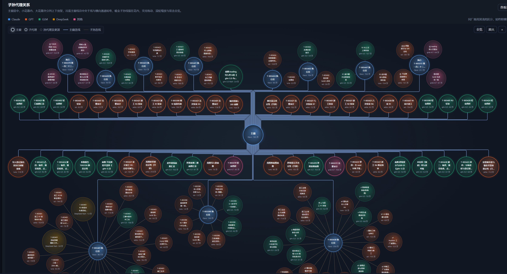

<div align="center">

# md-workflow · 蜂巢式子代理 · 百万级代码工程 skill

       

[English](README.md) | [中文](README.zh-CN.md)

</div>

**可选：先让 AI 设计产品研发文档。** 在任意 AI 聊天窗或代码窗贴这一句：`执行 https://github.com/comkocs/md-workflow/blob/main/desk/先核对产品需求.md 的全部指令，帮我设计产品研发文档，多轮改到定稿；如果打不开链接，请让我下载这份 md 拖进对话框。`已有完整产品需求与研发路线文档的，可以跳过这一步。

**开始搭建工作流。** 在项目目录开一个 AI 代码窗（Claude Code 或 VS Code）贴这一句：`执行 https://github.com/comkocs/md-workflow/blob/main/desk/开始搭建工作流.md 的全部指令，先按我的情况选择新项目、接管老项目或只装流程；新项目先只做需求对接，我确认后再建仓；全程在我的授权范围内，并保留我指定的人工拍板点。`

## 🧭 总览

md-workflow v2.1 包含宪法 14 闸减法版、首次需求对接窗、四档子代理、短书、记忆钩子与本机运行看板。可全自动运行，拍板点可按需保留。保持轻便：只装 Claude Code 或 VS Code 就能跑，不需要任何 harness；带 harness 的版本叫 Panedesk。已经过大型 MMORPG 工程实战验证。引擎手写代码 327,866 行（另有引擎场景／资源等资产文本 31,334 行）· 服务端代码 168,845 行 · 办公代码 51,799 行——按 git 跟踪文件计，统计截止 2026-10-18（UTC-7）／2026-10-19 03:53（UTC+8）。

连配置数据与文档一起算，该工程按 git 跟踪文件合计约 400 万行工作文本（代码约 55 万、配置与数据约 257 万、文档约 90 万）。AI 项目的构建与传递，靠的就是这样的海量文本；本项目能不断优化文本、淘汰文本——指针记忆覆盖式重写而不是追加，减法审定期淘汰不再值得留的规矩。



*运行看板「子孙代理关系」视图，取自该工程的一次真实会话：主窗居中，子代理沿主干排开，孙代理围在各执行员四周，按模型家族着色，每个节点标出用量。*

记忆与接管是内核，工单台是工作通道，宪法提供流程闸口。可以只用独立 skill、只装工具，也可以采用整套工作流。主要目录是工具 `core/`、宪法／角色／模板／记忆规范 `desk/`、新项目裁剪用的通用规矩集 `desk/真源/`，以及演练案例 `examples/`。

## 🚀 新项目第一窗

第一窗先核对需求，有产品文档就直接从文档判定。然后从 `desk/真源/` 的真源条目表里按项目裁出作业规矩：条目表共 215 条，源自一个百万行 MMORPG 项目的现行规矩，每条都带「为什么」与加回条件。预计代码 20 万行内默认总编 + 技术总监；超过才建议按模块加总监。一窗到底只在用户点名时用。使用顶部「开始搭建工作流」的一键句，选新项目分支即可。

## 🧰 独立 skill

每个 skill 都有自己的指令与配套材料。前八个是建议优先选择的核心项，顺序与 [skill 一览](desk/skill一览.md) 一致。分类共三类：**单独装即可用**、**装 core/ 即可用**、**需要 md-workflow 全套**；最后一类不能宣传成脱离工作流也能独立使用。

安装时，把 `.agents/skills/<skill-name>/` 整个目录拷到你项目的 `.agents/skills/` 下。依赖工具的 skill 还要拷 `core/` 并按下文单独安装；依赖全套工作流的 skill 则须保留其流程依赖。想让 AI 代装，把 `<skill-name>` 换成要装的名字（如 `pointer-handoff`）后贴这一句：

```text
把 https://github.com/comkocs/md-workflow 克隆到一个临时目录，把其中 .agents/skills/<skill-name>/ 整个目录拷到我项目的 .agents/skills/ 下，再读该 SKILL.md，按我项目的实值填好其中占位，定不了的问我。
```

### ⭐ `hive-dispatch` — 蜂巢式派遣

**分类：单独装即可用。** 帮你切活、在顶级／困难／日常／轻量四档中选档、写清派遣边界，并核验交回的成果。顶级由主窗本体承担，其余按活派子代理。主窗定边界、看证据，不凭施工者一句「做完了」放行；审计不过或同活连续失败两次就升档。派遣步骤与角色定义随 skill 自带。

### ⭐ `pointer-handoff` — 指针记忆

**分类：单独装即可用。** 把越堆越长的接管记录改成一份固定名现状件。§一 覆盖式重写当前状态、阻塞、在办事项与下一步；§二 只留稳定的真源路径和命令指针，历史流水放归档。压缩或换窗前先保存核实过的接续点。每次回复都报实际存了什么，没存就明确说「记忆未动」，不会把未落盘的对话冒充持久记忆。

### ⭐ `memory-writing` — 记忆写入与索引

**分类：单独装即可用。** 在证据还清楚时，记下以后还会用到的规矩、纠正或教训。先查同题，一文件一事实，按要求写正文三段和源案例，再在索引对应节加一行。自带规范覆盖新建、更新与删除，让下一窗能直接找到规矩，不必重读对话。

### ⭐ `context-guard-hooks` — 记忆钩子

**分类：装 core/ 即可用。** 安装并自查两道提示钩子：写文件后检查旧词、写死版本、体积超限或章程缺节，压缩后回灌已保存的现状。回灌配合 `/compact` 使用，手动 `/compact` 或自动压缩后由 `SessionStart(compact)` 触发。这两道钩子只提示，不拦截编辑，也不会替你保存缺失的现状。第三道 `危险命令拦.py` 会拦四种危险 Bash 命令并回替代命令。skill 讲清配置合并、JSON 手动自查、来源识别与只装工具时的能力边界。

### ⭐ `ticket-desk-usage` — 工单台用法

**分类：装 core/ 即可用。** 按自己的角色找到那几步工单命令：接活、认领交板、派活判活、记录阻塞、查待答、复验收尾。配套说明区分只读写本机的数据入口与可连服务器的入口，也区分「导出任务书」和「真的派出子代理」。只拷 `core/` 并填好办公目录键即可使用工具，不要求安装工作流宪法。

### ⭐ `verify-agent-claims` — 核子代理与他人报告（防幻觉）

**分类：单独装即可用。** 在别人报「没有」「没人用」「做完了」「已提交」「会崩」「全绿」时先做防幻觉核实。问清对方看的树与版本、怎么算的，再换一条路独立核实物后才采信。避免搜漏、旧检出或把注释当行为得到的结论，被写成下游事实。

### ⭐ `top-audit-dispatch` — 独立顶级审计（防幻觉）

**分类：单独装即可用。** 一单并入后，另派独立审计者按需求和实际交付物做防幻觉核验，不照施工者的自述判。审计把幻觉、笔误、漏做、未核与环境限制分开，首行给计数，下列具体不符项。返工再并后另起新审计，不沿用施工上下文；自带提示词与报告材料支持独立核实。

### ⭐ `subtraction-review` — 减法审

**分类：单独装即可用。** 定期清闸账、当日口径、预算表与历史附录，避免规矩只加不减。按实证判退役、带理由续期或转长期，产出六块减法审报告并登记裁定。步骤和模板自包含，项目记录与裁定簿由使用方提供。

### `first-window-requirements` — 首次需求对接

**分类：单独装即可用。** 新项目建仓前，先逐字收需求、归纳十题填需求卡、按尺子判档、裁出作业规矩、选预设，再确认思维导图、产品文档与原型图或架构图。确认后把范围拆成模块与单，填好代码规范，有相关素材时才补素材管理规范。所需骨架自带；需同时拷 `desk/真源/`；证据不齐不能靠编功能或提前建仓补过去。

### `legacy-project-onboarding` — 老项目接入

**分类：单独装即可用。** 先让老窗口做一份有边界的记忆导出，再核新窗口理解了什么、缺什么。对齐术语与规矩冲突后再选接入范围，默认保留现有规矩和真源，只补已授权的缺口。覆盖导出、导入、兼容、范围与第一窗，不把接入当成扫描或重写老项目的许可。

### `short-book-drafting` — 短书起草

**分类：单独装即可用。** 把大型工单压成五块：出题、已定口径、判据与改动面、底数指针、并线／审计／未核要求。主窗定要什么和只许改哪里，施工主窗直派子代理施工；回退线才交执行员。自带短书、轻闸工序与派遣要求，交清边界，而不是把任务书扩成长串行脚本。

### `zero-window-taskbook-drafting` — 0 号任务书起草（选用，仅双窗）

**分类：需要 md-workflow 全套。** 只在甲类大型触发宪法 0.1 回退线任一条、需要独立执行员窗时使用。开工前核五块短书、底数、文件白名单、交接、审计与偏离要求。默认单窗走 `short-book-drafting`，不能只因任务大就另开第二窗。

### `contract-and-test-infra` — 前后端契约与测试基建

**分类：单独装即可用。** 后端交前端前，先补真实消费者，而不是把对接缺口往下游推。核接口契约、状态可复位、拒因可读与自动完整流程，同时照顾兼容的契约扩展、运行时配置和假传输层回放。适合交付前或联调明显超时，用前换成自己的契约、复位命令、场景命令与配置位置。

### `frontend-integration-preflight` — 前端对接预检

**分类：单独装即可用。** 前端动手前先核三件：契约齐、卡住的状态能复位、不连真服也能靠回放或场景到达目标界面。三件都可用才开工。缺一件就说清缺口退回后端补，前端先做别的；本 skill 只核准备度，不代替后端实现测试基建。

### `shared-checkout-safety` — 共用检出与工作树

**分类：单独装即可用。** 一单一工作树，暂存只带明确归自己改的路径，避免并发窗口互踩。遇到陌生改动、推送被拒、共享进程或支头不符，先看清再处理。避免广泛暂存、破坏性重置和改写共用提交，防止本机核验悄悄验成别人的代码。

### `engineering-pitfalls-checklist` — 工程坑清单

**分类：单独装即可用。** 把六类常见工程坑写成症状、先跑的检查、结果怎么看，包括首字节多出不可见内容、回报与对应版本对不上、运行时版本不符、shell 乱码或命令被吞、测试时过时不过。先按症状做对应检查，再决定是不是代码问题；回报实测证据，不先猜原因。

### `merge-and-deploy` — 并线上服

**分类：单独装即可用。** 在项目授权范围内，按固定顺序重建组合树、构建与测试相关改动面、查祖先、并线、推送和部署。显式带保留线上设置的旗标，上线后回读运行版本及其他实证再收尾。没有线上服务的项目跳过部署步骤；skill 本身不授予推送或上服权限。

### `closeout-report-drafting` — 收口报告起草

**分类：单独装即可用。** 真做完才写短、可逐条核对的收口报告，没做完改写交接件。按固定四块骨架与收尾问题写，区分已完成、待别人接着做与偏离。哈希、计数、文件名用命令核，篇幅按字符量，不凭感觉估长度。

### `window-handoff-drafting` — 换窗归档起草

**分类：单独装即可用。** 旧窗快满或要转交工作时，按接手角色选模板，留下当前现状与下一步。固定现状节覆盖式重写，历史流水进归档。核指针、数字和未完事项，让下一窗不用整读历史也能续做。

### `memory-index-folding` — 记忆索引折叠

**分类：需要 md-workflow 全套。** 索引将满或加载末尾被截断时，把一整节原样挪入二级分册，原处只留一行入口。先备份、预演、折叠，再逐条对照，不能靠删教训来瘦身。依赖全套工作流的索引规范与折叠工具。

### `open-source-preflight` — 开源前检查

**分类：单独装即可用。** 公开前核准备发布的树和历史，查秘密、部署信息、本机路径、身份与缺再分发权的素材。能跑的扫描与须人工确认的版权、授权证据分开；缺工具或证据记未核，不冒充零命中。skill 本身不授权发布、重写历史或自行移除素材。

### `claude-session-observability` — 本机会话看板

**分类：装 core/ 即可用。** 用本机运行看板查看窗口、子孙代理树、时间轴、在跑并发、按模型与按单用量、规矩报警及历史。只覆盖 Claude Code 会话记录，不包含 codex／zcode 窗；只读记录，不修改记录、不展示对话正文。还给出价目、计费口径与报警配置位置，避免未配口径就把估算当成已核费用。

### `repo-scale-reporting` — 代码规模统计

**分类：装 core/ 即可用。** 按 git 跟踪文件量一个或多个仓，通过明确分类规则把代码、测试、配置与文档分开。报告写统计截止时间、解析后的版本、扩展名与排除项，以及空行、注释和合并是否计入。工具也量指定时间窗的提交与增删量；不带树与口径的数字不能复现。

### `doc-pointer-check` — 文档断引用检查

**分类：装 core/ 即可用。** 核 Markdown 的闸号、版本号、路径、任务引用、文件与行五类指针。只核有边界的改动时可指定扫描根，也可对比上一跑只看新增悬空。工具只读被扫件、把结果写入报告目录，退出码恒为零，所以要看悬空清单，不能把进程成功当作没有断引用。

## 🧠 记忆钩子与指针接管

先保存现状，不靠更长的聊天记录。固定一份 `接管_现状.md`：§一 写此刻实情、阻塞、在跑代理与下一步；§二 列稳定真源路径和命令。现状覆盖式重写而不是追加日记，历史进归档，交接前核指针。每次回复分清真存了记忆还是记忆未动，见 [`pointer-handoff`](.agents/skills/pointer-handoff/SKILL.md)。

`core/tools/hooks/` 三道钩子各管一件事。第三道 `危险命令拦.py` 在 `PreToolUse(Bash)` 拦截 `rm -rf`、`git reset --hard`、强推（`--force` / `-f`）到 main、`git worktree remove --force`，拒时回一行可直接跑的替代命令。`防回潮检查.py` 在 `Write|Edit|MultiEdit` 后由 `PostToolUse` 提示；`压缩后回灌.py` 配合 `/compact`，手动 `/compact` 或自动压缩后由 `SessionStart(compact)` 触发。回灌已存现状节、当日口径与近期仍在跑的子代理，认不出本位时只给当日口径。压缩前先保存，没写下来的事实不能靠钩子找回来。

三脚本只用标准库；两道记忆钩子只输出提示、不拦截编辑，第三道会拦截上述四种危险 Bash 命令。按 [`context-guard-hooks`](.agents/skills/context-guard-hooks/SKILL.md) 合并事件配置、保留原设置并核实际回灌来源。压缩摘要保住三样：带时刻的拍板、跨窗数值与时段、在跑代理及其等待项和返回动作。退出码为零或没有输出都不能单独证明安装成功；只装 `core/` 时，需要外置流程词表或预算表的检查会跳过。

## ⭐ 单独安装：工单台与运行看板

不装宪法也能用工单台与运行看板：只拷 `core/` 一个目录到自己选的工具目录，把 `core/desk_config.json` 的「办公目录」改成自己的办公文件目录，该目录可以尚不存在。工具只用 Python 标准库，不依赖 `desk/`、`.agents/` 或工作流宪法。要用的 skill 按上文另装。

在所拷 `core/` 的父目录运行。有 `python` 用 `python`；没有时将 `python -X utf8` 换成 `py -X utf8`，其余参数（含 `-I`）不变：

```bash
python -X utf8 core/start.py
python -X utf8 core/t.py -h
python -X utf8 -I core/tools/dashboard/server.py
```

第一条起工单台，第二条列只读写本机数据的命令行用法，第三条以隔离模式独立起看板；打开各服务终端打印的本机地址，前台服务按 Ctrl+C 停止。本机工单台已起时，点顶栏「运行看板」即可同进程、同端口打开，不必再起第二个看板进程。看板只覆盖 Claude Code 记录，不改会话记录。覆盖范围与配置详见 [看板说明](core/tools/dashboard/README.md)。

把这一句激活指令贴给 AI，它会自己从 GitHub 拉取项目：

```text
把 https://github.com/comkocs/md-workflow 克隆到一个临时目录，只把其中的 core/ 拷到我选定的工具目录，把 core/desk_config.json 的「办公目录」设为我的办公文件目录（两个目录我没给就先问我），再用 python -X utf8 core/start.py 启动本机工单台并打开顶栏「运行看板」，不安装工作流宪法、不改我的现有规矩。
```

想独立演练工单台，用 `python -X utf8 core/start.py --demo`，演示数据与正式台分开。完整走一张单见 [演练说明](examples/README.md)。

## 🏗️ 启动整套工作流

这是全套路线（工单台 + 总监位 + 14 闸）；新项目先走上一节 [新项目第一窗](#-新项目第一窗)。

读 [开始搭建工作流](desk/开始搭建工作流.md)，在首页选 **新项目**、**接管老项目** 或 **只装流程**。新项目先完成首次需求对接再建仓；老项目先保留并核现有规矩与真源；只装流程跳过需求对接，适用时沿用现有仓。

在项目目录开一个 AI 代码窗，贴顶部「开始搭建工作流」的一键句；该文件会自己克隆项目。

整套工作流把指针记忆、工单制、独立核验与减法宪法合在一起。产品版本是 **v2.1**；现行宪法文档为 **v2.3**，共 **14 闸**，其中核心 11、可选 3。全自动仍受用户授权约束，按需保留人工拍板，核心闸不能当可选开关关掉。档位用于分工，不绑定某个模型：顶级由主窗做，困难、日常、轻量可交子代理。

## 📄 许可

采用 [Apache-2.0](LICENSE)。再分发或发布衍生作品时须按许可第 4 条保留 [NOTICE](NOTICE) 中的归属声明。

## 📖 作者亲笔

这个项目诞生于一次失败。8月25日，我写下第一行代码。一个月，60多万行有效C#代码，游戏完整运行，每天都在不断更新中，目前md-workflow项目已经迭代到 v2.1 了。
